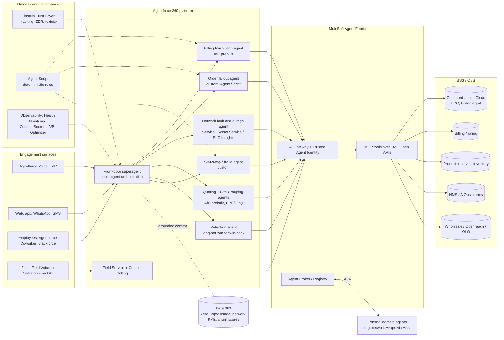

# Agentic working model for telecoms (post-Dreamforce 2026) — architecture notes

Companion to the Page of the same name. Mermaid sources for the diagrams, the ADRs and
the trade-offs. Product status labels (GA / Beta / Pilot) are as Salesforce stated them
around Dreamforce 2026 (15–17 Sep 2026); check them against current release notes
before you commit to a plan.

## 1. Reference architecture



## 2. Sequence — billing dispute with authority threshold

```mermaid
sequenceDiagram
  autonumber
  actor C as Customer (WhatsApp)
  participant SA as Superagent
  participant TL as Trust Layer
  participant BR as Billing Resolution agent
  participant MF as MuleSoft (MCP / TMF)
  participant H as Billing supervisor (HITL)
  C->>SA: "Charged roaming in France, I'll leave"
  SA->>TL: screen injection, mask PII
  SA->>SA: intents = [billing_dispute, churn_risk]
  SA->>BR: delegate billing_dispute
  BR->>MF: TMF629 GET customer
  BR->>MF: TMF678 GET latest bill
  BR->>BR: Agent Script rule: plan includes EU roaming -> line invalid
  alt amount <= £50 and customer not vulnerable
    BR->>MF: TMF678 POST adjustment
    BR-->>SA: resolved
  else above authority or vulnerable
    BR->>H: approval task (proposed credit, evidence)
    H-->>BR: approve / reject
    BR->>MF: TMF678 POST adjustment (if approved)
  end
  SA->>SA: secondary intent churn_risk -> Retention agent (offer within policy; switching never obstructed)
  SA-->>C: outcome + offer
```

## 3. Sequence — network fault to resolution with proactive comms

```mermaid
sequenceDiagram
  autonumber
  actor C as Customer (voice)
  participant SA as Superagent (Agentforce Voice)
  participant NF as Network fault agent
  participant MF as MuleSoft (MCP / TMF)
  participant NOC as NOC / AIOps agent (A2A)
  participant FSL as Field Service
  C->>SA: "Broadband down since this morning"
  SA->>NF: delegate network_fault
  NF->>MF: TMF629 customer, TMF637 product inventory
  NF->>MF: TMF642 active alarms for LS1
  alt known incident
    NF->>MF: TMF621 find parent ticket; create child ticket
    NF->>NOC: A2A: subscribe for restoration event
    NF-->>C: ETR + text on restoration (TMF681 comms)
    Note over NF: truck roll suppressed; auto-compensation clock started
  else no incident
    NF->>MF: line test (TMF653-style service test)
    NF->>MF: TMF621 create ticket
    NF->>FSL: book appointment (TMF646)
    NF-->>C: appointment confirmed
  end
```

## 4. Agent autonomy levels used in the operating model

| Level | Name | Agent may | Human role |
|---|---|---|---|
| L0 | Assist | Summarise, draft, recommend | Human acts |
| L1 | Act with approval | Prepare the transaction | Human approves each action |
| L2 | Act within limits | Execute below policy thresholds | Human handles exceptions |
| L3 | Act and report | Execute end to end, sampled QA | Human audits and tunes |
| L4 | Long-horizon goal | Pursue a goal over days/weeks with check-ins | Human sets goals and guardrails |

## 5. Architecture decision records

**ADR-01 Single front door (superagent) with specialist subagents.**
Decision: one customer-facing orchestrator per brand across voice and digital, routing to
narrow specialist agents. Why: Dreamforce 2026 positioned multi-agent orchestration with a
superagent as the pattern (Southwest Airlines example). Trade-off: routing errors become a
single point of failure, so routing gets its own test suite and A/B experiments.

**ADR-02 BSS/OSS access only through MuleSoft-fronted TMF Open APIs exposed as MCP tools.**
Why: reuse existing API estate (AT&T reported MuleSoft connecting 50+ legacy systems),
central policy (AI Gateway), per-agent identity, vendor-neutral contracts (TMF629/620/622/
641/642/621/678). Trade-off: one more hop and licence; mitigated by caching read-only lookups
in Data 360.

**ADR-03 Money-moving and security actions are deterministic (Agent Script / Flow), not free LLM reasoning.**
Credits, refunds, SIM swaps, port-outs and order resubmission follow coded rules with
thresholds held as configuration. The LLM chooses a route; it never decides an amount.

**ADR-04 Start from Agentforce for Communications prebuilt agents, then extend.**
Billing Resolution, Quoting and Site Grouping (GA Feb 2026), SLO Insights and Guided Selling.
Build custom agents only for gaps (order fallout, SIM-swap fraud, UK auto-compensation).

**ADR-05 Data 360 with Zero Copy for usage, network and billing history; ingest for profile.**
Avoids replicating CDRs/xDRs. Trade-off: query latency and federated cost; keep hot
features (churn score, open incidents per area) as calculated insights.

**ADR-06 Federate network domain agents via A2A rather than pulling network logic into Salesforce.**
Network AIOps stays in the OSS/hyperscaler domain; Agentforce consumes outcomes. Trade-off:
cross-vendor observability; register external agents in Agent Fabric's registry.

**ADR-07 Commercials: per-user Industries add-on for employee agents, Flex Credits for customer-facing.**
Flex Credits and Conversations cannot coexist in one org. Model voice actions at 30 credits
versus 20 for standard actions. Re-check when the Agentforce Industry editions land.

**ADR-08 Model choice stays open.**
Default platform models now; evaluate Koa (pilot, GA expected Winter 2026) on telco
transcripts in a sandbox against the same scorers before switching.

## 6. Mapping from the prototype to the target platform

| Prototype | Target |
|---|---|
| `Orchestrator` | Agentforce superagent (multi-agent orchestration) |
| `RuleBasedReasoner` / `LLMReasoner` | Agentforce reasoning engine; Koa or other model choice |
| `guardrails.py` | Einstein Trust Layer + Agent Script + Custom Metadata thresholds |
| `ToolGateway` | MuleSoft Agent Fabric (AI Gateway, Trusted Agent Identity), MCP |
| `tmf_stubs.py` | TMF Open API implementations over BSS/OSS |
| `HumanQueue` | Omni-Channel queues, Slack approval workflows |
| `Trace` | Agentforce Observability session traces, Agent Health Monitoring |
